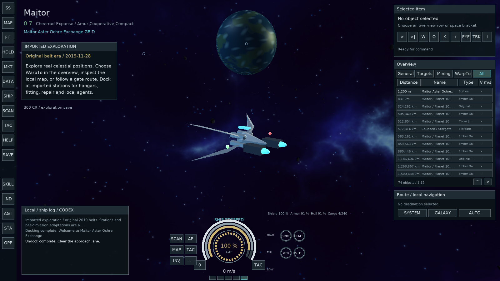
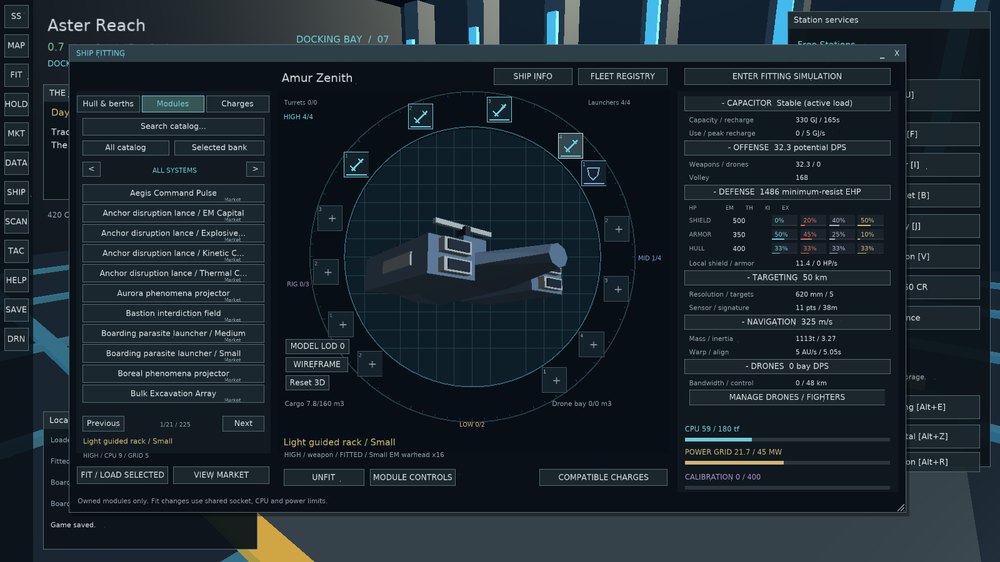
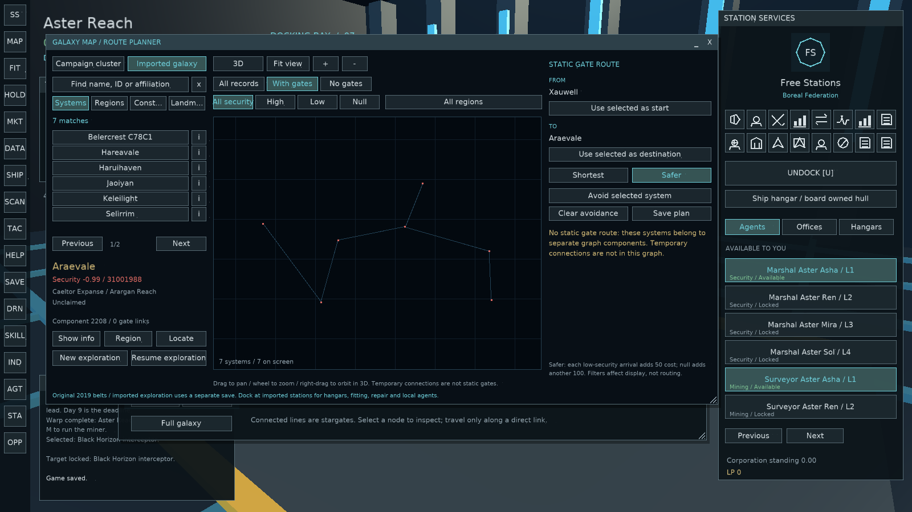
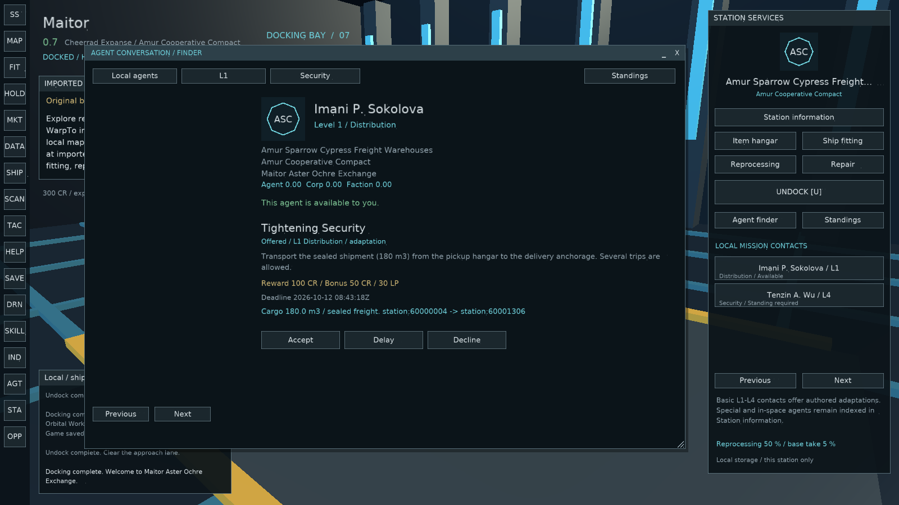
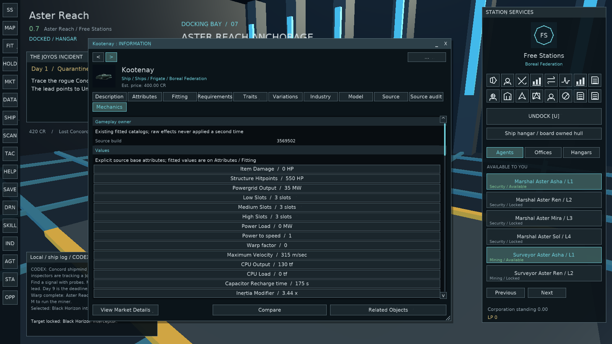

# Starlight Syndicate

**A single-player, science-fiction sandbox built with C# and MonoGame.**

Explore a sprawling star cluster, pilot and outfit spacecraft, trade and manufacture equipment, hire crews, run missions, build industrial operations, and make your own way through a living simulated economy. The setting features JoyOS, the Concord of Worlds, and the Syndicate of Worlds, with an EVE-inspired desktop interface and a persistent, offline campaign.

> **Development build / public-release warning:** This is a substantial playable *work in progress*, not a finished or independently certified game. Its original source package included a large set of EVE Online-derived static-data records. The applicable permissions for distributing those records as part of a standalone game **have not been established**. **Do not publish this archive or create a public binary release until the data/rights issues in [Legal & assets](docs/LEGAL_AND_ASSETS.md) are resolved.**



[Installation](docs/INSTALLATION.md) · [How to play](docs/PLAYER_GUIDE.md) · [Features and limitations](docs/FEATURES.md) · [Developer guide](docs/DEVELOPMENT.md) · [Data & licensing](docs/LEGAL_AND_ASSETS.md) · [GitHub setup](docs/GITHUB_SETUP.md)

## At a glance

- **Open-ended star-system exploration:** spatial navigation, stargates, an explorable galaxy map, bookmarks and scanning.
- **Ships and fitting:** specialized hulls, modules, capacitor, drones, heat and damage, ship models with multiple levels of detail, saved fittings and simulation.
- **Economy:** market orders, cargo and hangars, finite mining, reprocessing, manufacturing, blueprints, jobs, trade and logistics.
- **People and factions:** AI pilots, agents, standings, recruitment, missions, fleet roles and autonomous economic activity.
- **Organizations and territory:** corporations, structures, asset custody, fleet operations, regional objectives and optional territorial involvement.
- **Deep sandbox activities:** planetary colonies, moon mining, research, invention, mutated equipment, expeditions, exploration sites and event encounters.
- **Offline persistence:** character, economy, organizations, systems, jobs and simulation clock are saved locally.



<details>
<summary>More screenshots</summary>

| Galaxy & route planning | Station services |
| --- | --- |
|  |  |



</details>

## Install and run

**Intended target:** Windows desktop, .NET 8 / MonoGame DesktopGL. The original delivery contained a bundled Windows executable, but this **source release intentionally omits built binaries and .NET runtime files**. A prebuilt Windows release can be generated using the included workflow after rights clearance and build verification.

1. Install the [.NET 8 SDK](https://dotnet.microsoft.com/en-us/download/dotnet/8.0).
2. Clone or extract this repository, retaining its `Assets` directory.
3. From the repository root, run:

   ```powershell
   dotnet restore StarlightSyndicate.sln
   dotnet run --project Source/StarlightSyndicate.csproj -c Release
   ```

The first build needs access to NuGet to restore **MonoGame.Framework.DesktopGL 3.8.5.1**. For alternative publishing commands, runtime requirements, troubleshooting and save locations, read [Installation](docs/INSTALLATION.md). The full `Assets/` tree is required to play.

## Your first session

Start a new game and choose a background, then explore the desktop's left-hand **SS** application menu. Use **Station Services** to open hangars, fitting, the market and agents. Undock to explore, select objects from the overview, and issue navigation, targeting and interaction commands. Open the fitting window to configure a ship and the galaxy map to choose the next system. The game has many activities, but there is no enforced main quest.

See the [Player guide](docs/PLAYER_GUIDE.md) for a practical tour of the interface and early activities.

## Current status

This repository consolidates the source of the **Q01–Q07 implementation** over the inherited A–P systems. Those seven areas have functional workflows, but **all seven remain partial** compared with their comprehensive source-game parity goals. NPC recipes, balancing rules, UI details, content and some combat/economy behavior are still authored approximations. Save format schema 54 is retained; back up existing saves before updating. See [Features and limitations](docs/FEATURES.md) for specifics.

**Build verification:** Project structure, asset presence and the Python model-tool test have checks provided in-repo. The game was **not compiled or launched in this packaging environment** because the .NET SDK is not installed here; do not treat the bundled source as a verified shipping binary. Windows/MonoGame CI is included for subsequent testing.

## Contributing and project organization

`Source/` contains gameplay, simulation, desktop UI, renderer and test C# code. `Assets/` contains data and *runtime-required* generated models, thumbnails and spatial files. `Art/` contains editable source recipes and faction art definitions. `tools/` contains the procedural model generation and validation scripts. `docs/` hosts player/developer documentation and curated screenshots. The historical stage reports, bundled runtime DLLs, validation dumps and redundant exports are not part of the repository.

Read [Contributing](CONTRIBUTING.md) before submitting changes, including the rules for data provenance and non-original assets. Use the included issue forms for bugs and feature requests.

## Rights, trademarks and license

**No public code license has been selected for this packaging pass.** [LICENSE](LICENSE) documents that no permission to reuse or redistribute the project is granted merely by access to the files. Project-specific source-code licensing is a decision for the rights holder; it cannot license external EVE data or third-party dependencies. See [Legal & assets](docs/LEGAL_AND_ASSETS.md) **before making the repository public**.

Starlight Syndicate is an unofficial independent prototype. It is not affiliated with, sponsored by, or endorsed by CCP Games or the creators of EVE Online. EVE Online and related marks belong to their respective owners.
